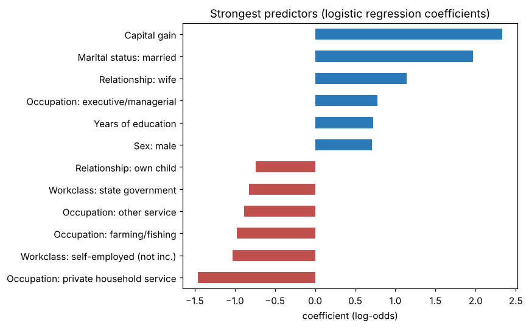
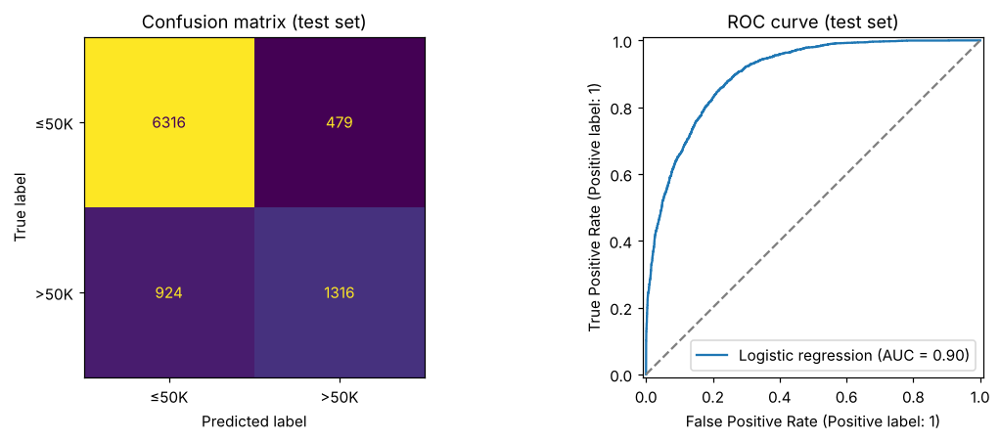

# Income Classification — UCI Adult Census Data

Predicting whether a person earns more than $50K a year from 1994 US Census data, using logistic regression in Python and scikit-learn. The project covers data cleaning, exploratory analysis, model training with cross-validation, evaluation beyond accuracy, and a plain-language explanation of the strongest predictors.



## Results (20% held-out test set)

| Metric | Logistic regression | Baseline (always "≤50K") |
|---|---|---|
| Accuracy | 0.845 | 0.752 |
| Precision (>50K) | 0.733 | – |
| Recall (>50K) | 0.588 | – |
| F1 | 0.652 | – |
| ROC-AUC | 0.900 | 0.500 |

5-fold cross-validated ROC-AUC on the training set: **0.905 ± 0.003**, so performance is stable across splits.

## Key findings

- **Capital gains** is the strongest predictor (odds ratio ≈ 10 per standard deviation).
- **Being married** multiplies the odds of earning >50K by about 7 compared with never-married people, largely an age and household effect.
- **Education:** each standard deviation (≈ 2.6 years) roughly doubles the odds.
- **Occupation:** executive/managerial roles raise the odds; private household service, farming/fishing and other-service roles lower them.

## Data

[UCI Adult dataset](https://archive.ics.uci.edu/dataset/2/adult) (Becker & Kohavi, 1996), 48,842 records, 14 attributes, licensed CC BY 4.0. After removing rows with missing values and duplicates: 45,175 records, 24.8% earning >50K.

## Method

1. **Cleaning:** converted `?` to missing values and dropped those rows (3,620 rows, 7.4%); removed 47 duplicates; dropped `fnlwgt` (a survey weight) and `education` (duplicate of `education_num`); grouped rare countries into United-States vs Other.
2. **Preprocessing:** standardized numeric columns, one-hot encoded categorical columns, inside a scikit-learn `Pipeline` so the test set never leaks into training.
3. **Model:** logistic regression, compared with a most-frequent-class baseline; 5-fold stratified cross-validation.
4. **Evaluation:** accuracy, precision, recall, F1, ROC-AUC and a confusion matrix, because the classes are imbalanced (≈ 1 in 4 earn >50K).
5. **Interpretation:** coefficients converted to odds ratios.



## How to run

```bash
pip install -r requirements.txt
jupyter notebook notebooks/income_classification.ipynb
```

## Limitations

The data is from 1994 and US-only, so it shows historical patterns. Results are associations, not causes. Sensitive attributes (sex, race) are kept only to describe the data and should not be used for real decisions about people.

## Repository structure

```
├── data/adult.csv.gz                       raw data
├── notebooks/income_classification.ipynb   full analysis
├── images/                                 charts and metrics.csv
├── requirements.txt
└── README.md
```

*Author: Mohammed Mudabbir Ahmed · B.Sc. Data Science, Memorial University of Newfoundland · [LinkedIn](https://www.linkedin.com/in/mmudabbirahmed)*
